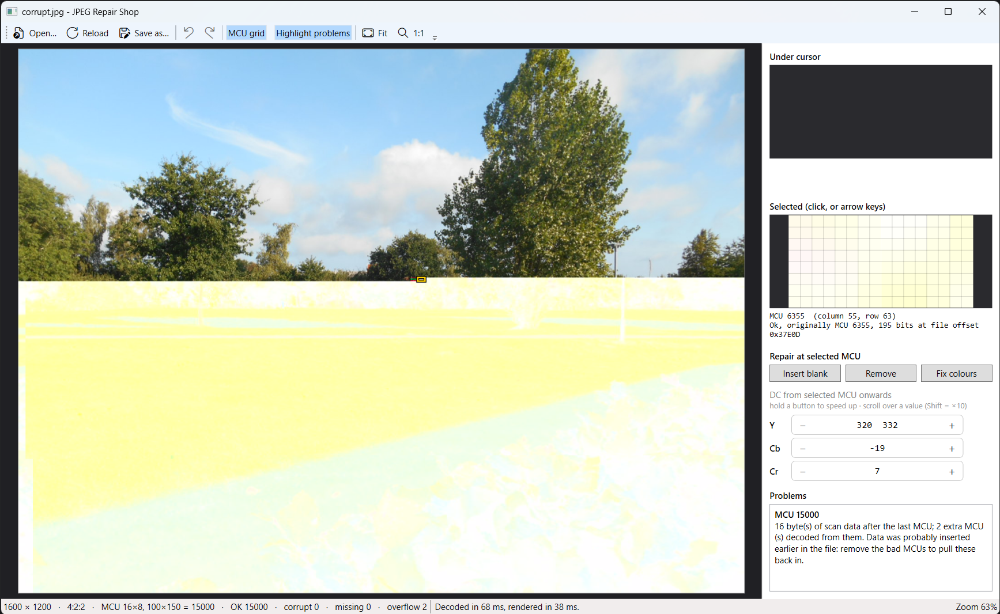

# JPEG Repair Shop (.NET)

A .NET port of [JPEG Repair Shop](https://anderspedersen.net/jpegrepair/), a Windows tool for repairing corrupt
JPEG files by editing the image data inside the file.

The original was written in C++ with Qt. This version is C# with WPF and [SkiaSharp](https://github.com/mono/SkiaSharp).
The port was made with [Claude Code](https://claude.com/claude-code) and contains a number of bug fixes and
enhancements.



## What it does

A JPEG picture is stored as a long stream of small blocks called MCUs (minimum coded units). When part of a file is
lost or overwritten, every block after the damage can end up in the wrong place, or with the wrong colours. JPEG
Repair Shop shows you the blocks and lets you put them back:

- **Insert blank MCU**: shifts everything after the selected block one step right (use where data was lost).
- **Remove MCU**: shifts everything after it one step left (use on garbage blocks).
- **Fix colours**: corrects the colour/brightness shift from the selected block onwards by matching it to the row above.
- **Adjust DC by hand**: fine-tune brightness (Y) and colour (Cb, Cr) from the selected block onwards. The buttons
  speed up when held down; Shift + mouse wheel moves 10 steps at a time.
- **Undo / redo** for every edit.
- **Borrow a header** from another picture, when the file's header (picture size, colour layout, compression
  tables) is damaged but the image data is still there. Works best with a picture from the same camera,
  taken with the same settings.
- **Save as** a new file. Everything before the image data (EXIF, colour profile, comments) is kept as it was.

### Viewing damaged files

- The decoder keeps going through damaged data instead of stopping at the first error, so as much of the picture
  as possible is shown. Blocks with invalid data are marked in red, blocks with no data at all with a red cross,
  and the problems found are listed with their position in the file.
- Zoom and pan freely, with an optional MCU grid. Enlarged previews show the block under the cursor and the
  selected block, together with their DC values.

### Supported files

- Baseline JPEGs, including camera and phone photos with 4:2:0, 4:2:2 or 4:4:4 colour sampling, and grayscale.
- Files with **restart markers**, including files where some markers are damaged or missing.
- Files with a **damaged header**, by borrowing the header of another picture.

Progressive JPEGs are not supported.

## Requirements

- Windows
- [.NET 10 SDK](https://dotnet.microsoft.com/download)

## Build and run

```
dotnet build JpegRepairShop.slnx
dotnet run --project JpegRepairShop
dotnet test
```

You can also pass a file to open: `JpegRepairShop.exe broken.jpg`.

## Project layout

| Folder | Contents |
|---|---|
| `JpegRepair.Core` | JPEG parsing, decoding, rendering, re-encoding, the edit model with undo, header borrowing. No UI dependencies. |
| `JpegRepair.Core.Tests` | xUnit tests, including damaged-file scenarios. |
| `JpegRepairShop` | The WPF application. |

## Tips

- Always keep the original file. Saving writes a clean, re-encoded file, and repairs that need the original
  damaged data can't be redone from the saved copy.
- Repair the original file from the camera or memory card. A picture that was re-compressed or re-uploaded
  after it was damaged usually can't be repaired.

## License

Released under the [MIT License](LICENSE).
