# JPEG Repair Shop user guide

This guide explains why a JPEG that looks ruined can often be repaired, and how to do it with JPEG Repair Shop.

- [How a JPEG is stored](#how-a-jpeg-is-stored)
- [Why a corrupt file can often be recovered](#why-a-corrupt-file-can-often-be-recovered)
- [Getting started](#getting-started)
- [Fix all, step 1: lining up rows](#fix-all-step-1-lining-up-rows)
- [Filling the holes](#filling-the-holes)
- [Fix all, step 2: fine-tune](#fix-all-step-2-fine-tune)
- [Colours and garbage rows: Fix section colours](#colours-and-garbage-rows-fix-section-colours)
- [Repairing by hand](#repairing-by-hand)
- [Bad MCUs and marks](#bad-mcus-and-marks)
- [Damaged headers](#damaged-headers)
- [Saving](#saving)
- [Controls](#controls)
- [Tips](#tips)

## How a JPEG is stored

A JPEG file starts with a **header** that describes the picture (size, colours, the tables needed to decode it),
followed by the **image data**.

The picture is cut into small blocks called **MCUs**, typically 8 × 8 or 16 × 16 pixels. The MCUs are stored one
after another, left to right and row by row, with nothing in between. There is no "new row starts here" in the
file: the decoder only knows where an MCU goes by counting.

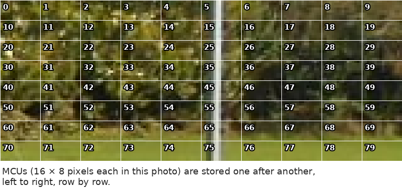

To save space, the overall brightness and colour of each MCU is stored as a **change from the MCU before it**,
not as a value of its own.

## Why a corrupt file can often be recovered

When a file is damaged, some bytes of the image data are lost, overwritten, or garbage ends up in the middle.
Picture viewers then show grey from that point, or a picture where everything below is shifted sideways and has
the wrong colours. It looks ruined, but usually it is not:

- **The data after the damage is still fine.** The decoder reads a little nonsense at the damaged spot, but soon
  gets back in step and decodes the rest of the picture correctly.
- **It just ends up in the wrong place.** Because the decoder counts MCUs to know where they go, every MCU after
  the damage lands a few places too early or too late.
- **And with the wrong colour.** Because brightness and colour are stored as changes from the MCU before, one
  error is carried on to everything after it.

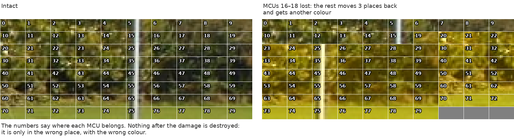

So repairing a picture is mostly a matter of moving the MCUs back into place and correcting the colours. The few
MCUs that were really lost can be filled in from the picture around them.

A picture that was edited, re-saved or re-uploaded after it was damaged usually cannot be repaired, and
progressive JPEGs are not supported.

## Getting started

Open a file with **Open…** (Ctrl+O) or drop it on the window. Work on a copy and keep the original.

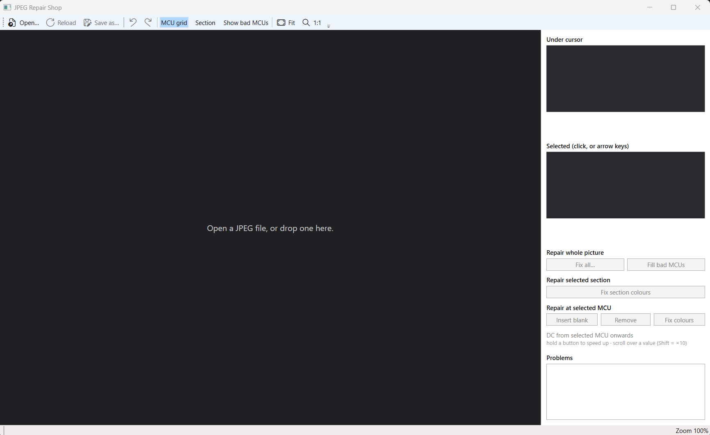

The picture fills most of the window. The panel on the right shows the MCU under the cursor and the selected MCU
enlarged, the repair buttons, and a list of problems found in the file. MCUs with invalid data are shown in red.

Let's see how simple a repair can be, using [lost-data.jpg](examples/lost-data.jpg). It is damaged in several
places: at each one, everything after it is shifted sideways and gets a different colour:

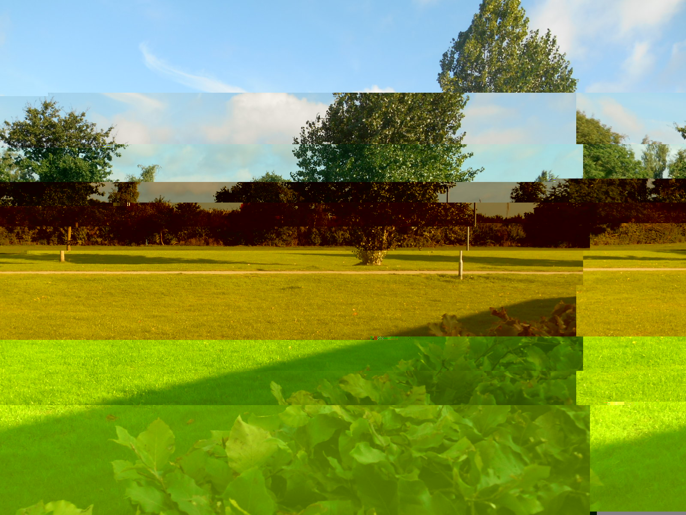

For most pictures, start with **Fix all…** (Ctrl+Shift+A). It works in two steps, and the first one is often all
you need.

## Fix all, step 1: lining up rows

In an intact picture each row of MCUs joins smoothly onto the row above it. Where something went wrong, it
doesn't. Fix all compares the rows with each other, finds where the picture stops fitting, and moves the MCUs from
there until they line up with the row above again. Then it corrects the colours to match. It keeps going, worst
damage first, until nothing more is found.

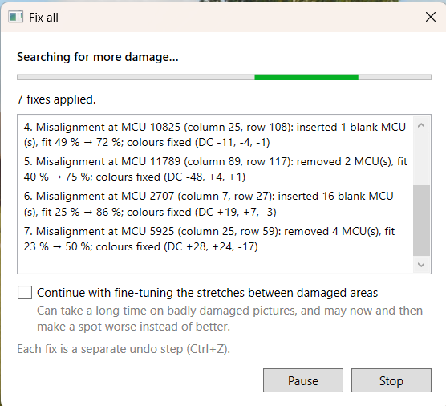

You can **Pause** to look at the picture so far, or **Stop** at any time. Every fix can be undone with Ctrl+Z.

After step 1, lost-data.jpg is back in one piece:

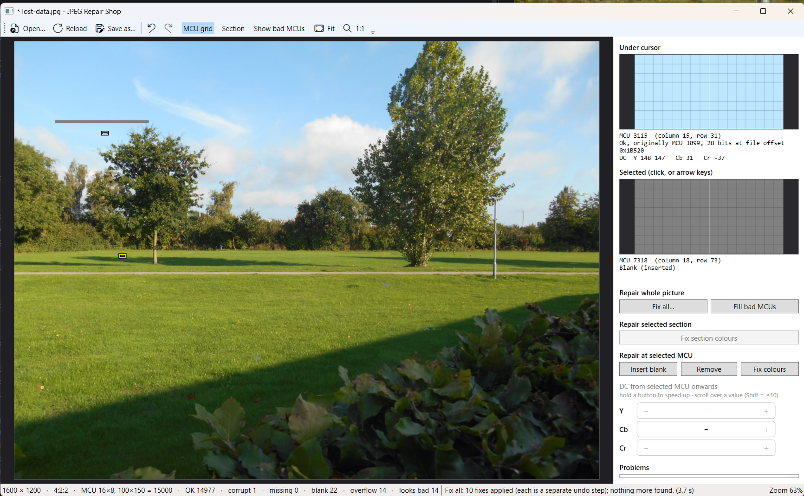

Look closely and you'll see a few small grey stripes. Those are places where data was really lost: Fix all inserts
grey blank MCUs there, so that everything after them lines up again. Next to them there are often a few MCUs of
garbage from the damaged data. Tick **Show bad MCUs** to outline in orange what JPEG Repair Shop thinks needs repair:

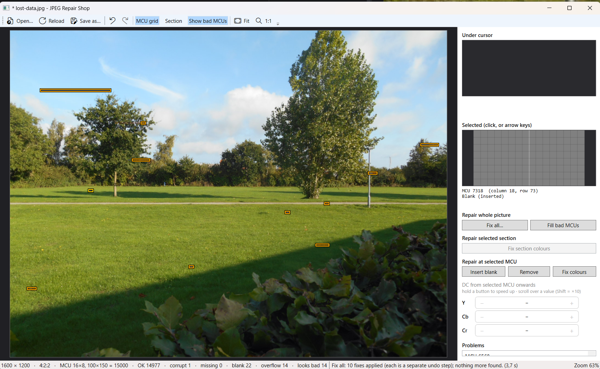

Telling garbage from real picture is guesswork: JPEG Repair Shop looks at how well each MCU fits in with its
neighbours. It can miss some garbage, especially where it happens to fit in, and it can outline good MCUs in a busy
part of the picture. Have a look yourself; see [Bad MCUs and marks](#bad-mcus-and-marks) for how to correct it.

## Filling the holes

The grey blanks and the garbage can't be repaired: that part of the picture is gone. What you can do is fill it in.
**Fill bad MCUs** (Ctrl+Shift+I) replaces every MCU outlined in orange with content made up from the picture around
it. It fills exactly what is outlined, so garbage that wasn't spotted stays, and good MCUs that were outlined by
mistake are replaced too:

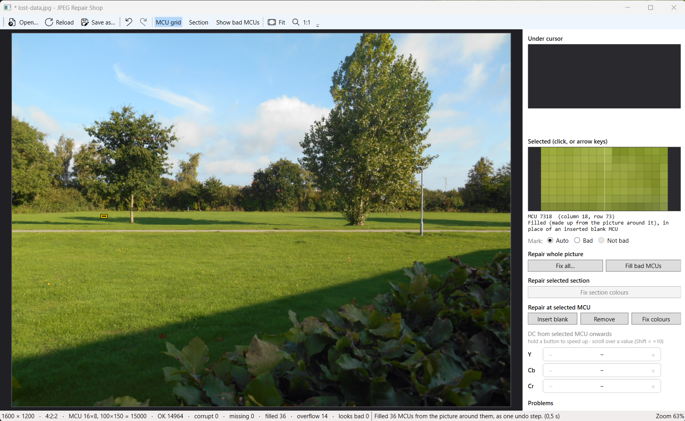

Because the fill is made from the picture around each hole, do it last, when everything is in place and the colours
are right.

For many pictures, step 1 of Fix all followed by Fill bad MCUs is all it takes. The rest of this guide is for damage
those two don't handle.

## Fix all, step 2: fine-tune

Step 1 looks at whole rows. A small error that doesn't fill a whole row can go unnoticed: the rest of the row is
right, so the row as a whole still looks fine. This typically leaves a short stretch with the wrong colour, or
moved a place or two.

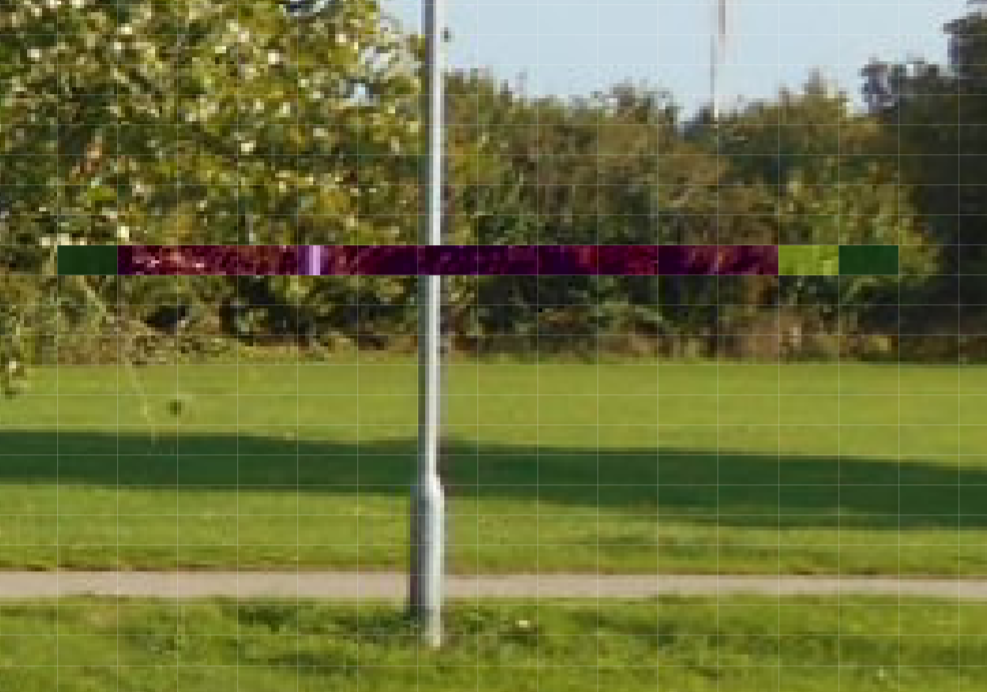

The second step goes looking for these short stretches and moves them and/or corrects their colours.

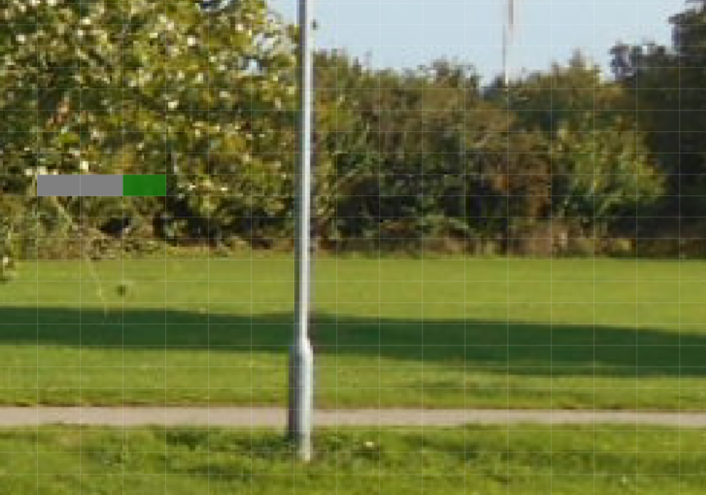

Step 2 is optional: tick or untick **Continue with fine-tuning the stretches between damaged areas** in the Fix all
window. If it is off, you are asked when step 1 is done. If you use it, do so before Fill bad MCUs.

> **Be careful with step 2.** A short stretch gives very little to go on, so now and then it "corrects" something
> that was not wrong, especially where the picture itself changes, like along a shadow or a horizon. Look over the
> picture afterwards and undo (Ctrl+Z) what you don't like. On badly damaged pictures this step can also take a
> long time.

## Colours and garbage rows: Fix section colours

Fix all and Fix colours match the colours to **the row just above**. If that row is garbage, the colours are
matched to the garbage, and the result can be way off.

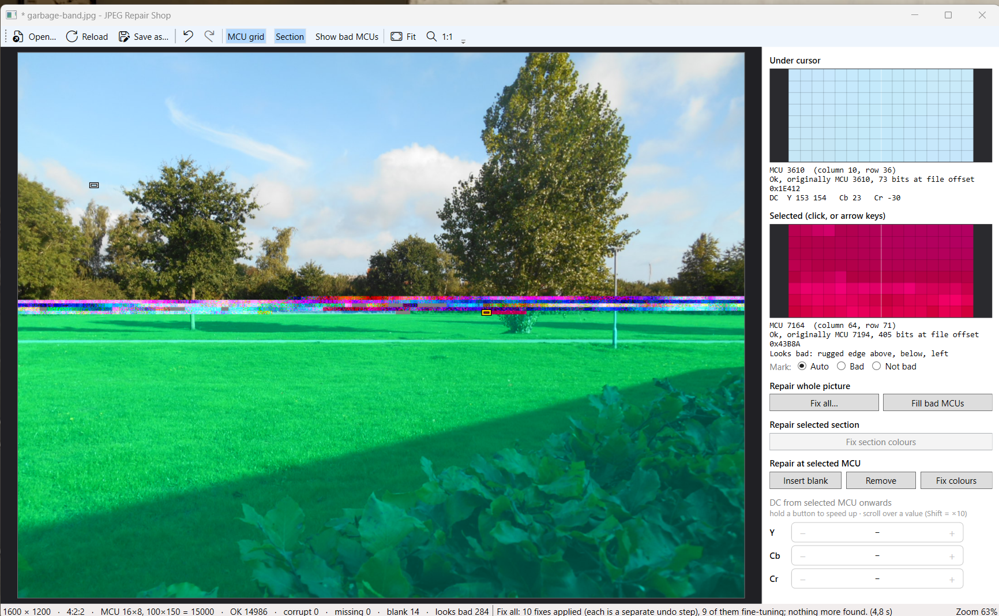

**Fix section colours** (Shift+F) is for this case. It compares the overall colours of a section with several rows
further up, skipping the garbage, and adjusts the section, and everything after it, to match.

1. Select an MCU in the part with the wrong colours and choose **Fix section colours** (Shift+F).
2. Choose how many **rows to look upwards** and click **Fix**.

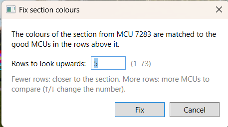

It works best when the area above looks like the section (the same lawn, the same sky). Because it also changes
everything after the section, work from the top of the picture down.

### What a section is

A **section** is a run of good MCUs around the selected MCU. It ends where it meets a bad MCU (red, orange, blank
or missing), in both directions. Tick **Section** in the toolbar to see it outlined in cyan.

If the section reaches further up than the part with wrong colours, mark the first MCU with wrong colours as bad
(B). The section then starts right after it.

## Repairing by hand

Select an MCU by clicking it (or with the arrow keys), then:

- **Insert blank** (Insert) adds a grey MCU here; everything after moves one place right. Use where data was lost.
- **Remove** (Delete) removes this MCU; everything after moves one place left. Use on garbage.
- **Fix colours** (F) matches the colours from here on to the row above.
- **Y, Cb, Cr**: adjust brightness and colour from here on by hand.

A typical manual repair: find the first MCU where the picture goes wrong, insert or remove MCUs there until the
rest lines up, then fix the colours from the same MCU.

## Bad MCUs and marks

Tick **Show bad MCUs** to see what needs repair:

| Colour | Meaning |
|---|---|
| Red | Invalid data |
| Faint red with a cross | No data: the file ran out |
| Orange | Looks like garbage (or marked bad by you) |
| Blue | Blank MCU you inserted |
| Green | Filled in from the picture around it |

Orange MCUs are only a guess, based on how well each MCU fits in with its neighbours. It catches most garbage, but
not all of it, and now and then it flags a good MCU in a busy part of the picture. Since several tools rely on it
(Fill bad MCUs, Fix section colours and the colour fixes), it is worth correcting. Press **B** (or use **Mark** in
the panel) to mark the selected MCU as bad or not bad. A red MCU whose picture still looks fine can also be marked not bad, so it is used
like a good one.

## Damaged headers

If the header is damaged, the picture cannot be shown at all. Click **Borrow header from other picture(s)…** and
choose an intact picture, ideally from the same camera with the same settings.

## Saving

**Save as…** (Ctrl+S) saves the repaired picture as a new file, keeping EXIF and other information.
**Reload** (F5) throws away all repairs.

## Controls

| Action | How |
|---|---|
| Open a file | Ctrl+O, or drop a file on the window |
| Save as a new file | Ctrl+S |
| Reload, discarding repairs | F5 |
| Undo / redo | Ctrl+Z / Ctrl+Y |
| Zoom | Mouse wheel, or + and − |
| Fit to window / actual size | Ctrl+0 / Ctrl+1 |
| Pan | Drag the picture |
| Select an MCU | Click it, or use the arrow keys; Esc clears it |
| Fix all | Ctrl+Shift+A |
| Fill bad MCUs | Ctrl+Shift+I |
| Fix section colours | Shift+F |
| Fix colours | F |
| Insert blank MCU | Insert |
| Remove MCU | Delete |
| Mark MCU bad / good | B |
| Adjust Y, Cb, Cr | − and + (hold to speed up), or mouse wheel over the value (Shift: 10 at a time) |

## Tips

- **Keep the original file.** Some repairs can only be done from the original damaged data.
- **Use the file straight from the camera or memory card.** A copy that was re-saved or re-uploaded after the
  damage usually can't be repaired.
- **Start with Fix all, then look it over.** Undo what went wrong, fix the rest by hand, and fill the holes last.
- **Work from the top down.** Every change also affects everything after it.
